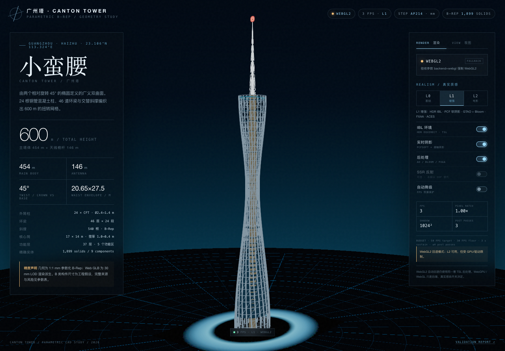

# 广州塔 / Canton Tower — 参数化 B-Rep 精确模型

**Live demo / 公网浏览：** <https://scrumpascrumpy.github.io/canton-tower-cad/>  
**Source repository：** <https://github.com/ScrumpAscrumpy/canton-tower-cad>  
**Exact CAD downloads：** <https://github.com/ScrumpAscrumpy/canton-tower-cad/releases/tag/v1.0.0>



> 600 m total · 454 m main body · 146 m antenna · 24 CFT columns · 46 ring levels · 37 floors · 45° twist

本目录交付一个可复现的 Python 无头 CAD 管线：由 `cad/params.py` 驱动 CadQuery 2.5.2 / OCCT 7.7.2 构建 1:1 mm B-Rep 装配体，导出 STEP AP214，按绝对线性偏差网格化为两个 GLB LOD，并由一个 Three.js WebGPU/WebGL2 双后端查看器渲染：优先 WebGPU，适配器/上下文不可用时自动回退 WebGL2；查看器不生成任何精确塔体几何。

## 1. 快速运行

```bash
# 在 workspace 根目录
cd canton-tower-cad

# 1) Python 3.12 环境（示例）
uv venv ../.venv-cad --python /opt/homebrew/bin/python3.12
source ../.venv-cad/bin/activate
uv pip install -r requirements.txt

# 2) 构建 STEP + GLB + 指标（约 3.5 分钟）
python cad/build_canton_tower.py

# 3) STEP 回读 + GLB 偏差 + 拓扑验证（约 1 分钟）
python cad/validate.py

# 4) 生成开发页与自包含 HTML
#    前端依赖已固定在 web-build/package.json
cd web-build
npm ci
npm run build:viewer
cd ..
python web/build_pages.py
```

打开 `canton-tower.html` 即可（自包含：GLB、HDR、ORM 贴图全部内联，可直接双击）。若使用 `web/index.html` 开发页，必须通过 HTTP 服务，因为浏览器会限制 `file://` 下的 GLB/HDR fetch：

```bash
python -m http.server 8765 --bind 127.0.0.1
# http://127.0.0.1:8765/web/index.html
```

## 2. 交付文件

> 公网浏览版使用 `index.html` + `assets/canton_tower_web.glb` + `web/bundle.js`。  
> 42 MB STEP 与 31.7 MB 参考 GLB 超过日常网页分发所需，未提交到 Git 仓库；它们在此工作区 `out/` 中，并作为 GitHub Release 附件上传。本地自包含版 `canton-tower.html` 也被 `.gitignore` 排除。

| 文件 | 说明 |
|---|---|
| `out/canton_tower.step` | 精确交付物，STEP AP214，mm，9 个命名组件 / 1,899 个闭合实体（本地 / Release） |
| `out/canton_tower.glb` | 参考 LOD：绝对线性偏差 5 mm，角度 0.2 rad，约 1.49 M tris（本地 / Release） |
| `out/canton_tower_web.glb` | Web LOD：绝对线性偏差 30 mm，角度 0.45 rad，约 380 k tris / 9.1 MB |
| `assets/canton_tower_web.glb` | 公网 Pages 使用的 Web GLB |
| `index.html` | GitHub Pages 浏览页（加载 assets + web/bundle.js） |
| `canton-tower.html` | 本地自包含查看器（内联 GLB base64 + HDR/ORM data URI，未提交仓库） |
| `web/index.html` | 开发页，加载 `../assets/canton_tower_web.glb` 与渲染资产 |
| `web/app.js` | Three.js 查看器源码，仅通过 GLTFLoader 加载 GLB |
| `cad/params.py` | 单一参数源；所有关键尺寸、派生函数、参数分级 |
| `cad/build_canton_tower.py` | 建模、布尔、STEP 导出、GLB 网格化 |
| `cad/validate.py` | STEP 回读、实体/壳体检查、GLB 偏差抽样 |
| `reports/validation_report.md` | 验证报告（自动生成） |
| `reports/parameter_sources.csv` | 参数来源表（37 条） |
| `reports/requirements_and_assumptions.md` | 需求确认、假设、数据取舍 |
| `reports/feature_tree.md` | 特征树与依赖 |
| `reports/build_metrics.json` | 分组体积、质量、包围盒、网格统计 |
| `reports/validation.json` | 机器可读几何验证结果 |
| `reports/render_layer.md` | 后端选择、真实质感分级、性能预算、验收说明 |
| `reports/render_validation.md` | WebGL2 自动回退、L0/L1/L2、运行时开关、自动降级实测 |
| `assets/render_assets.json` | HDR / ORM / GLB 资产清单与许可 |
| `assets/generate_render_assets.py` | 程序生成 HDR 与 ORM 贴图（CC0） |
| `tools/shot.mjs` | CDP 截图/运行态验收工具 |

## 3. 渲染层协议实施

### 3.1 后端

- 启动时检测 `navigator.gpu` 与 WebGL2；优先 `WebGPURenderer`。
- WebGPU 适配器缺失、初始化失败、设备/上下文丢失 → 自动使用 WebGL2 后端；运行时不要求用户改代码。
- 顶栏、RENDER 面板与 `window.__RENDER__.backend` 均显示实际后端。
- 上下文丢失由 `webglcontextlost` / `device.lost` 监听触发自动重建；保留场景与模型。

详细说明：[render_layer.md](reports/render_layer.md)。

### 3.2 真实质感等级（默认 L1）

| 等级 | 主要效果 | 默认 | 说明 |
|---|---|---|---|
| L0 | PBR 参数、单方向光+环境光、无阴影/IBL/后处理、ACES+sRGB | 可选 | 低端/快速预览 |
| L1 | ORM 贴图、HDR IBL、PCFSoft 阴影+接触阴影、GTAO+Bloom+FXAA、ACES | **是** | 产品展示默认 |
| L2 | L1 + DoF、2048² 阴影、24-sample AO、略强 Bloom | 可选 | 电影感；WebGL2 下同样可运行 |

SSR/折射/体积光/运动模糊未启用；UI 的 SSR 开关禁用并提示“本版以 DoF 替代”。

### 3.3 开关与预算

- 开关：`realismLevel`、`enableIBL`、`enableShadows`、`enablePostProcessing`、`enableSSR`、`enableAutoQuality`。
- 性能预算：目标 50 FPS；连续 3 s < 30 FPS 自动 L2→L1→L0；最高 4 个后处理 pass；L0/L1/L2 阴影 0/1024²/2048²；像素比上限 1.0/1.5/1.75。
- 运行时屏幕与验收：

```js
__RENDER__.backend              // 'WEBGPU' | 'WEBGL2'
__RENDER__.level                // 'L0' | 'L1' | 'L2'
__RENDER__.config               // {ibl, shadows, post, ssr}
__RENDER__.state.autoDowngrades
__RENDER__.setLevel('L2')
__RENDER__.setConfig('post', false)
```

### 3.4 可验收 URL

- 默认（自动回退）：<https://scrumpascrumpy.github.io/canton-tower-cad/>
- 强制 WebGL2：`?backend=webgl`
- 固定 L0/L2、关闭自动降级：`?level=L0&auto=0`、`?level=L2&auto=0`
- 单开关：`?ibl=0`、`?shadows=0`、`?post=0`

> 当前 headless 验证环境没有可用 WebGPU adapter，因此自动回退、L0/L1/L2、运行时开关、自动降级已在 WebGL2 下实测；WebGPU 正路径需在支持 WebGPU 的普通浏览器中打开确认。详见 [render_validation.md](reports/render_validation.md)。

---

## 4. 关键工程决策

- **内核**：CadQuery 2.5.2 + OCCT 7.7.2。目标为建筑/结构尺度、多成员装配和可复现 B-Rep 布尔，Python 无头管线优于浏览器 OCCT.js（无需 WASM 内存/线程不确定性），也比 Rhino/OpenNURBS 更适合自由脚本化交付。
- **坐标系**：STEP 右手系，X 东、Y 北、Z 上；地面 Z=0，原点在基座包围盒底面中心。GLB 为 Y-up、米，仅作为渲染派生。
- **基座基准**：公开资料给出外筒 60×80 m 椭圆在 −10 m。为了与“地面以上 600 m”总高一致，模型将基座椭圆放在 Z=0，腰 280 m 与顶 454 m 保持不变。该 10 m 基准平移在报告中明确标注。
- **环梁表达**：46 个标高 × 24 段直线圆管；直线段比 24 点周期样条更接近“环梁连接 CFT 节点”的成员拓扑，并显著降低网格量。资料给出的 15.5° 倾斜因缺少节点放样表未施加，列为 B 类几何简化。
- **装配而非全局融合**：1,899 个成员级闭合实体保留在 9 个命名组件中。结构节点处成员相互穿插是成员级结构模型的正常交换方式；全局布尔融合 1,899 个构件既慢又易产生退化面，因此不做。
- **网格绝对偏差**：CadQuery 的 `Shape.tessellate()` 内部使用 `isRelative=True`，其 tolerance 并非 mm。本项目直接调用 `BRepMesh_IncrementalMesh(isRelative=False)` 并抽取三角化，确保 5 mm / 30 mm 是模型毫米单位下的绝对线性偏差。0.05 mm 对 600 m 建筑不可行（三角形数将放大数个数量级），因此采用分级 LOD：5 mm 参考、30 mm Web。
- **天线壳**：`shell(-120)` 在锥形八边形放样体上失败（`ValueError: Null TopoDS_Shape`）。已记录失败并使用**精确内八边形放样体布尔差**回退，不是网格近似。

## 5. 已知限制

- B 类构件直径、壁厚、楼层轮廓、核心筒偏心和天线细分均为工程假设，不是竣工数据。
- 未包含幕墙、电梯、MEP、室内、摩天轮、基础、节点螺栓、防火/防腐做法。
- 渲染层默认 L1；L2 为可选。SSR/体积光/运动模糊未启用；WebGL2 下 DoF 可用。
- headless 验证环境无 WebGPU adapter，WebGPU 正路径未在自动化中点亮；自动回退与 WebGL2 已实测。
- 天线为“薄壳 + 外部空间框架”的混合简化；真实结构为八边形钢空间桁架。
- 不是施工图，不用于结构计算、承载安全、消防或法规符合性判断。
- 几何实体质量约 126,432 t，高于公开总质量约 100,000 t；这是“无空腔、无装修、保守假设”的几何体积估算，不是结构工程量清单。

## 6. 许可与数据

几何由本项目脚本生成。公开尺寸来自 Wikipedia、HKIE 2012 封面故事与 Zhang Peng 2015/2016 PolyU 博士论文，详见 `reports/parameter_sources.csv`。模型为研究/展示用途，不主张与真实建筑完全一致。
